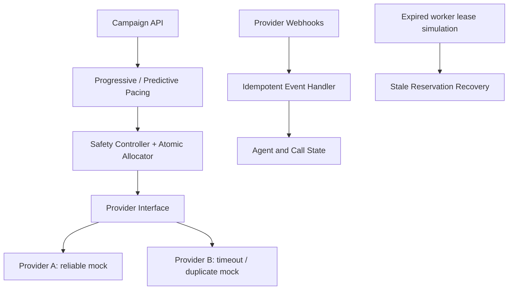

# Architecture and design decisions

## Agent lifecycle
AVAILABLE → RESERVED → CONNECTED → AVAILABLE after completion. Setup failures and explicit stale-reservation recovery release an agent.

## Call lifecycle
QUEUED → RESERVED → RINGING → ANSWERED → COMPLETED. Provider setup failures become FAILED. Expired in-flight reservations can be marked CANCELLED and returned to the borrower queue.

## Safety and concurrency
The allocator performs the availability check and reservation under one process-local lock, so threads in this process cannot reserve the same agent simultaneously. It never starts more calls than available agents. This is not a distributed lock and does not coordinate multiple processes.

## Predictive pacing
Requested calls = min(queued borrowers, round(available agents × estimated answer rate)). The allocator independently enforces the hard capacity limit. This simple formula is explainable and is a demonstration, not a trained model.

## Provider outage
Provider setup failures release reservations. Repeated failures open a simple circuit breaker that rejects new dial attempts until the simulator is reset. A production circuit breaker would use rolling failure windows, half-open probes and provider health metrics.

## Event correctness
Event IDs are deduplicated in memory. Terminal states cannot be reopened. A late RINGING event cannot regress an ANSWERED call.

## Production evolution
Use a transactional database with conditional updates for atomic reservations, durable idempotency keys, worker leases/heartbeats, an event inbox/outbox, shared coordination and measured load tests.
